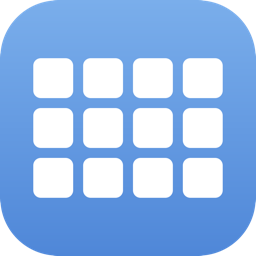

<p align="center">
  
</p>

<h1 align="center">dots</h1>

<p align="center">
  <strong>Your Mac at a glance, in a few dots.</strong><br>
  A tiny native menu bar monitor for Apple Silicon: per-core CPU load, memory,
  GPU, network latency or battery — drawn as a small glyph, not numbers.
</p>

<p align="center">
  <strong>Free and open source</strong> · Native AppKit · No telemetry<br>
  ~13 MB of memory · well under 1% of one core
</p>

<p align="center">
  <code>brew install --cask AlmazKo/tap/dots</code>
</p>

---

## One glyph, five modes

Right-click the dots to switch mode. Every mode takes the same space in the
menu bar, so nothing next to it shifts when you switch.

<table>
  <tr>
    <td width="50%" valign="top">
      <h3>CPU</h3>
      One cell per core, brighter as it gets busier. Performance cores sit on
      the top row, efficiency cores below with a hole. The whole matrix turns
      red as the chip nears its throttling temperature.
    </td>
    <td width="50%" valign="top">
      <h3>Memory</h3>
      A level meter of used memory — wired, active and compressed, counted the
      way Activity Monitor counts it.
    </td>
  </tr>
  <tr>
    <td width="50%" valign="top">
      <h3>GPU</h3>
      GPU load as a bar per second, newest on the right.
    </td>
    <td width="50%" valign="top">
      <h3>Latency</h3>
      An ICMP ping once a second with a scale that adapts from 50 ms to 1 s.
      Timeouts show as red bars.
    </td>
  </tr>
  <tr>
    <td width="50%" valign="top">
      <h3>Battery</h3>
      Charge as a battery glyph, on Macs that have one.
    </td>
    <td width="50%" valign="top">
      <h3>Out of the way</h3>
      A click opens Activity Monitor. The menu sets the refresh rate (1–10 Hz)
      and Launch at Login.
    </td>
  </tr>
</table>

## ⚡ Light by design

dots is a pure AppKit application with no dependencies. Only the sensor behind
the visible mode is running, the battery mode wakes up only when the charge
changes, and the glyph is redrawn only when what it shows changes.

---

## 📦 Install

Install with Homebrew:

```bash
brew install --cask AlmazKo/tap/dots
```

Or download the latest DMG from
[GitHub Releases](https://github.com/AlmazKo/Dots/releases) and drag dots to
`/Applications`. The app and DMG are signed, notarized and stapled, so the first
launch works offline.

### Requirements

- macOS 14 Sonoma or newer on Apple Silicon (M1 or newer).

<details>
<summary><strong>Build from source</strong></summary>

<br>

```bash
git clone https://github.com/AlmazKo/Dots.git
cd Dots
open dots.xcodeproj
```

Choose your own development team in Xcode under *Signing & Capabilities*, then
press **⌘R**. You can also build without signing by setting
`CODE_SIGNING_ALLOWED=NO`.

</details>

---

## 💜 Free and open source

dots is free to use and is released under the [MIT License](LICENSE). Issues,
ideas and contributions are welcome.
